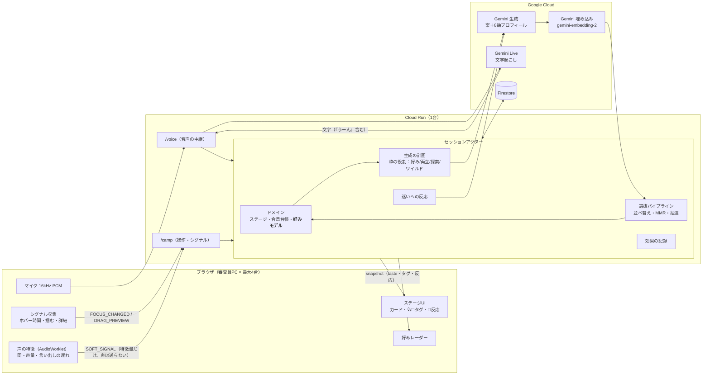
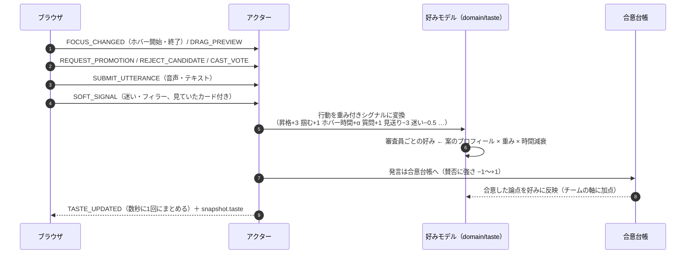
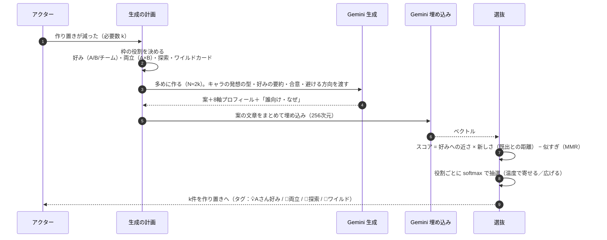
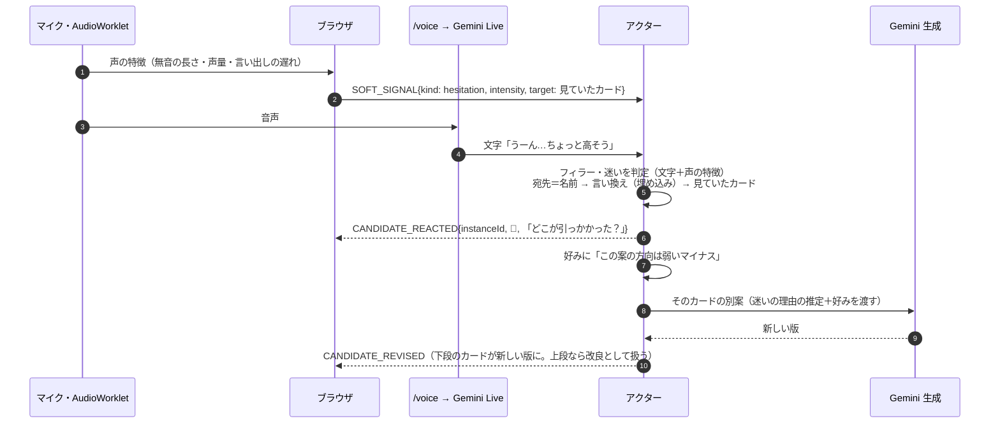
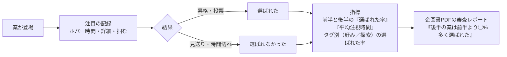
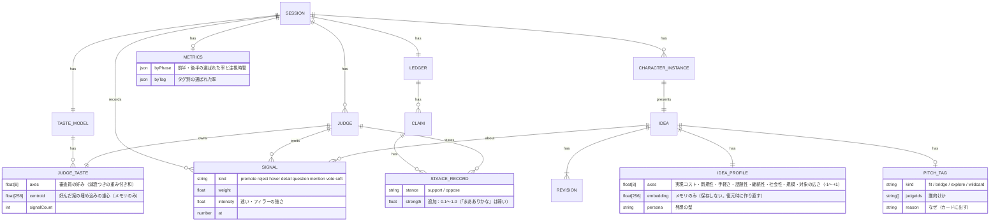

# ADR-0009: 好みエンジン — 言葉・行動・迷いから好みを読み、次の案の出し方を変える

- Status: Accepted（2026-11-08 実装。設計からの変更は末尾の「実装メモ」）
- Owner: 牧 夢斗
- Updated: 2026-11-08
- 関連：ADR-0004（CAMP）、ADR-0005（AI）、ADR-0006（注目度）、ADR-0007（合意台帳）、ADR-0008（企画書）

## Context

- テストユーザー・友人の声：「案がショボい」「意外性が少ない」「何度も再プロンプトするのと何が違うの？」「会議がどう変わるのかイメージしづらい」。
- 現状（2026-11-08）：
  - 合意台帳は「全体の過半数」しか見ない。**個人ごとの好みは持たない**
  - 行動（ホバー・掴む・見送り）は下段の入れ替えには効くが、**案の中身にはほぼ効かない**
  - 曖昧な反応（「うーん」）は**扱っていない**。賛否は2値
  - 埋め込みは使っていない。言い換え（「さっきのくじっぽいやつ」）は拾えない
  - 案は1回のプロンプトで作るだけで、多様さ・質の管理がない
- コンセプト：**「言わなくても、空気を読んでくれる企画会議」**。プロンプトに書けないもの（行動・迷い・言葉にできない好み）を使うことが、再プロンプトとの違いになる。

## Decision（提案）

3つの「魔法の瞬間」を、1つの**好みエンジン**の上に作る。

| 瞬間 | ユーザーが見るもの | 支える技術 |
|---|---|---|
| ① 言ってないのに分かってくれた | 寄ってくる案、「💡 Aさん好み：手軽さの案によく止まっていた」、好みのレーダー | 案の8軸プロフィール＋埋め込み、審査員ごとの好みベクトル、多めに作って並べ替え（MMR）＋確率的な抽選 |
| ② 割れても橋をかけてくれる | 「🤝 両立案：AさんとBさんの間」 | 好みの差が大きい軸から指示を作って生成し、両方への近さで選ぶ |
| ③「うーん」に反応する | キャラが 🤔 → 「どこが引っかかった？」→ そのカードの別案 | CAMP の `SOFT_SIGNAL`（フィラー・迷い）、ブラウザ内の声の特徴、見ていたカード、言い換えの照合 |
| 証拠 | 審査レポートに「後半の案は前半より◯%多く選ばれた／長く見られた」 | 案ごとの注目と結果の記録 |

あわせて、案の質の底上げ（キャラごとの発想の型、質の高いモデル、多めに作って選ぶ）を行う。

---

## 1. 全体のアーキテクチャ



## 2. データの流れ

### 2-1. 好みが更新される流れ（瞬間①の入力）



### 2-2. 新しい案を選ぶ流れ（瞬間①②と案の質）



### 2-3. 「うーん」への反応（瞬間③）



### 2-4. 効果の証拠（審査レポート）



## 3. ER 図（追加・変更するもの）



- 埋め込み（256次元×案数）は Firestore の1ドキュメント（1MB）を圧迫するので**保存しない**。復元時に、案の文章からまとめて作り直す。
- 8軸のプロフィールと好みベクトルは小さいので、セッション状態として保存する。

## 4. CAMP の拡張

| 追加 | 種別 | 内容 |
|---|---|---|
| `SOFT_SIGNAL { kind: filler｜hesitation｜silence｜laugh, intensity 0〜1, target: instanceId｜null, features: {pauseMs, energy, onsetMs} }` | Ephemeral（クライアント→サーバー、中継しない） | 曖昧な反応。声そのものは送らず、ブラウザで計算した特徴だけを送る |
| `FOCUS_CHANGED` に `dwellMs` を追加 | Ephemeral | ホバーが終わったときの注視時間 |
| `TASTE_UPDATED { version }` | Event（まとめて数秒に1回） | snapshot に `taste { axes[], judges{judgeId: number[]}, team: number[], divergence: {axis, judgeA, judgeB}｜null }` |
| `CANDIDATE_REACTED { instanceId, kind, text }` | Event | キャラの 🤔 反応 |
| `CANDIDATE_REVISED { instanceId, revisionId }` | Event | 下段のカードの別案（新しい版） |
| `RevisionView.profile` / `pitchTag` | 項目 | 8軸と「誰向け・なぜ」 |
| 合意台帳の `set_stance.strength` | 項目 | 賛否の強さ |
| snapshot `metrics` | 項目 | 効果の指標（審査レポート用） |

## 5. アルゴリズム

- **好みの更新**：`taste_j ← taste_j · 0.5^(Δt/90s) + w(signal) · profile(idea)`（軸ごと。合意した論点はチームの軸に加点）
- **候補のスコア**（役割ごと）：
  - 好み枠：`fit = cos(profile, taste_target) + λ·cos(emb, centroid_target)`
  - 両立枠：`min(fit_A, fit_B)`（両方に近いものほど高い）
  - 探索枠：`novelty = 1 − max cos(emb, 既出)`
  - ワイルドカード：新規性の高さだけ
- **MMR**：`score − μ · max cos(emb, 既に選んだ候補)`
- **抽選**：`p ∝ exp(score / τ)`。τ（温度）でデモ中に「寄せる／広げる」を調整できる
- **枠の配分**（作り置き k 件）：好みが溜まるまでは探索とワイルドを多め → 溜まったら好み・両立を増やす（コールドスタート対策）
- **迷いの判定**：文字（「うーん」「どうかな」「まあ…」など）× 声の特徴（無音 ≥ 800ms、声量が低い、言い出しが遅い）→ intensity。宛先は 名前 ＞ 言い換え（埋め込みの近さ）＞ 見ていたカード

## 6. フォルダ構成（追加・変更）

```text
packages/protocol/src/
  taste.ts                     ★ TasteView / IdeaProfile / PitchTag / SoftSignal / Metrics のスキーマ
  messages.ts                    SOFT_SIGNAL・TASTE_UPDATED・CANDIDATE_REACTED・CANDIDATE_REVISED を追加
apps/server/src/
  domain/
    taste.ts                   ★ 好みモデル（更新・減衰・チーム・割れている軸）純粋関数
    selection.ts               ★ スコア・MMR・抽選（乱数は注入）純粋関数
    signals.ts                 ★ 行動 → 重み付きシグナルの対応表
    metrics.ts                 ★ 前半／後半・タグ別の指標
    consensus.ts                 賛否に strength を追加
  application/
    taste-service.ts           ★ シグナルの受け口、TASTE_UPDATED のまとめ、生成用の好み要約
    generation-planner.ts      ★ 枠の役割の配分、多めに作る→埋め込み→選抜
    hesitation.ts              ★ 迷いの判定（文字＋声の特徴）と宛先の解決
    session-actor.ts             上の3つを呼ぶ
    ports.ts                     EmbeddingPort、generateIdeas の入出力（プロフィール・役割）を拡張
  infrastructure/gemini/
    embedding-gateway.ts       ★ gemini-embedding-2（まとめて埋め込み、256次元）
    personas.ts                ★ キャラごとの発想の型（SCAMPER・逆転・異分野・制約・ペルソナ…）
    gemini-gateway.ts            生成に8軸・役割・誰向けを追加、別案（variant）
  infrastructure/fixture/        固定データにも8軸・タグ・別案を用意（無料で通しデモできるように）
apps/web/src/
  features/taste/
    TasteRadar.tsx             ★ 審査員ごと・チームの好みレーダー（SVG）
  features/voice/
    pcm-worklet.js               声の特徴（無音の長さ・声量）も計算
    prosody.ts                 ★ 迷いの検出 → SOFT_SIGNAL
  scene/
    PitchTag.tsx               ★ 💡/🤝/🧭/🎲 タグと理由
    LowerStage.tsx / FinalStage.tsx  🤔 反応・別案の演出
  features/champion/ProposalDocument.tsx  好みの変化と効果の指標を審査レポートに追加
```

## 7. 実装の順番（すべてやる前提）

| 順 | 内容 | 依存 |
|---|---|---|
| 1 | 案の8軸プロフィールと発想の型（生成の出力を拡張）、固定データにも付与 | — |
| 2 | 好みモデル（ドメイン）とシグナルの重み、TASTE_UPDATED、好みレーダー | 1 |
| 3 | 埋め込み、多めに作って並べ替え・MMR・抽選、💡/🧭/🎲 タグ | 1・2 |
| 4 | 両立枠（🤝） | 2・3 |
| 5 | 迷い：文字起こしのフィラー確認 → 文字＋見ていたカードで判定 → 🤔 反応と別案 | 2 |
| 6 | 声の特徴（AudioWorklet）と SOFT_SIGNAL | 5 |
| 7 | 言い換えの照合（埋め込み） | 3 |
| 8 | 効果の指標と審査レポート | 2・3 |
| 9 | テスト（純粋関数中心）、ブラウザで通し確認、デプロイ | 全部 |

## Alternatives

| 案 | 採用しなかった理由 |
|---|---|
| 好みを埋め込みだけで表す | 10分のセッションではデータが少なく、理由も説明できない。説明できる8軸を主役にし、埋め込みは補助 |
| 好みを LLM に要約させるだけ | 毎回の要約がぶれる。数値のモデルにすればテスト・可視化・抽選ができる |
| 声の抑揚をネイティブ音声モデルで読む | us-central1 のみで、費用と遅延が増える。まずブラウザ内の特徴量で十分 |
| 学習済みの推薦モデルを作る | 学習データがない。セッション内のオンライン更新で十分 |

## Consequences / リスク

- Gemini の呼び出しが増える：多めに作る分（1回の生成で件数を増やすだけ）と、埋め込み（まとめて1回）、別案。作り置きの頻度は変わらない。
- 好みはセッション内でしか学ばない（コールドスタート）。最初は探索とワイルドを多めにする。
- 文字起こしがフィラーを消す場合は、声の特徴が本命になる（実装の順5で確認）。
- 「好みに寄りすぎて似た案ばかり」にならないよう、MMR と探索枠で必ず散らす。指標でも確認する。

## Verification（予定）

- 純粋関数のテスト：好みの更新と減衰、割れている軸、スコア、MMR、抽選（乱数固定）、迷いの判定、指標の計算。
- 固定データで通し：好みのレーダーが動く、タグが付く、両立案が出る、「うーん」で 🤔 と別案、審査レポートに指標。
- 本物の Gemini で通し、生成の待ち時間と呼び出し回数を記録。


## 実装メモ（2026-11-08）

設計から変えた点と、まだやっていない点。

| 項目 | 設計 | 実装 |
|---|---|---|
| `SOFT_SIGNAL` の種類 | Ephemeral | CAMP の5種類目の **Signal**（返事なし・1人毎秒2件まで、ADR-0010） |
| 埋め込みのモデル | gemini-embedding-2 | **gemini-embedding-001**（256次元）。embedding-2 は複数の文をまとめて頼むと1件しか返さなかったため。固定データと失敗時は文字の2-gram を使うローカルの埋め込み |
| 発想の型の置き場所 | infrastructure/gemini/personas.ts | `application/personas.ts`（生成計画と固定データの両方で使うため） |
| 注視時間 | `FOCUS_CHANGED` に `dwellMs` を追加 | サーバーがホバーの開始と終了の時刻から計算する（プロトコルは変えない） |
| 選抜のタイミング | 生成時に選ぶ | **空いた枠ごとに、そのときの好みでストックから選ぶ**（ストックは最大12件） |
| 声の特徴 | 無音・声量・言い出しの遅さ | 「うーん」の形（揺れの少ない声が0.5〜1.8秒続いて0.6秒以上黙る）をブラウザ内で検出（`features/voice/prosody.ts`） |
| 好みのならし方 | — | `tanh(和 / 0.9)`、反応3回以上で「自信あり」 |

まだやっていないこと：

- 合意台帳の賛否の強さ（`strength`）。好みの更新には使っていない
- 言い換え（埋め込みの近さ）による迷いの宛先の推定。宛先は「名前 → 詳細を開いている → カーソルが乗っている」の順
- 実機のマイクでの「うーん」検出のしきい値の調整（合成音でのテストのみ）
