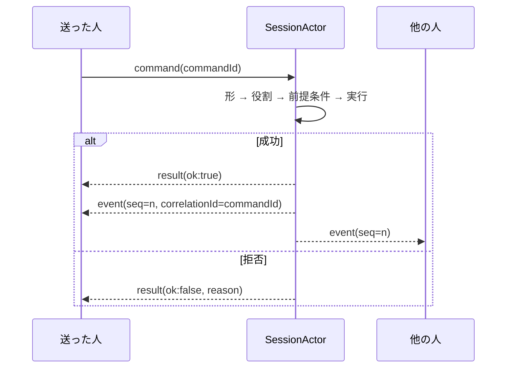
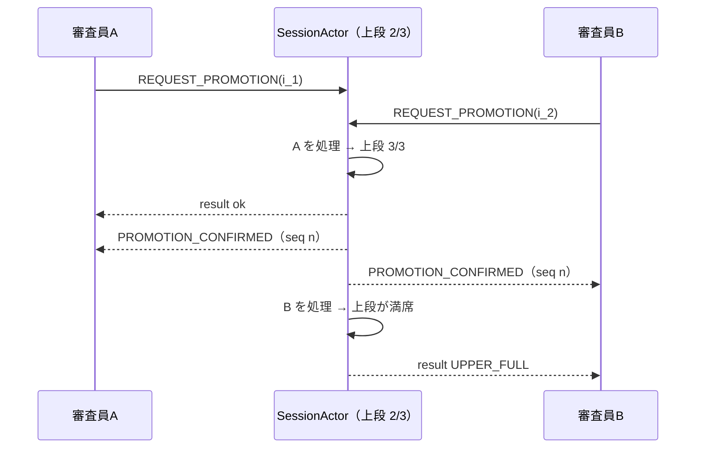
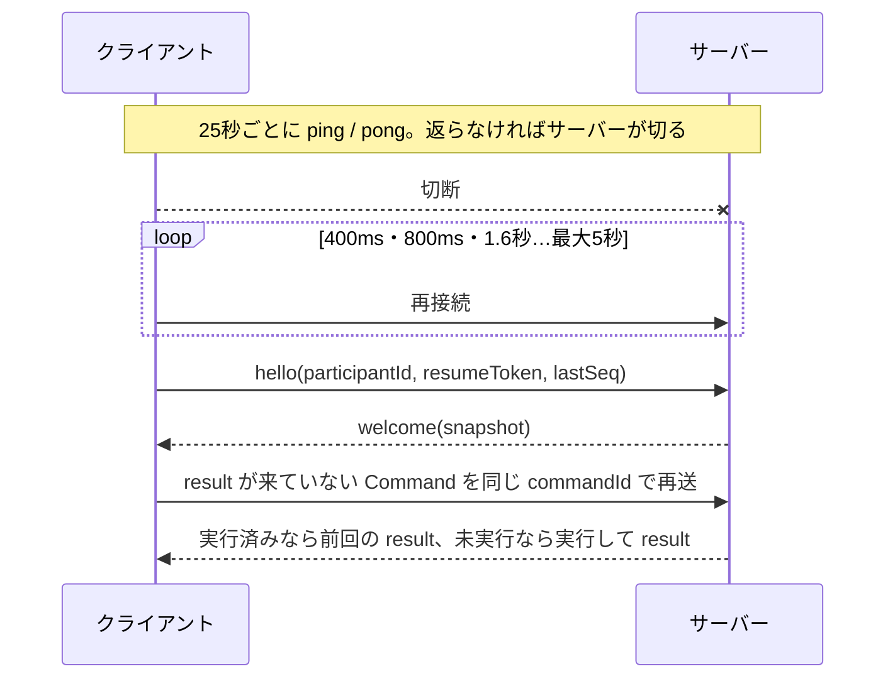

# CAMP v1 — Collaborative Agent Mediation Protocol 仕様書

> OSS 公開に合わせて、hello と welcome の `judgeId` を `participantId`、event の `actorJudgeId` を `actorId` に変えた（アプリの言葉を通信から外すため）。汎用の仕様（英語）は `packages/camp/SPEC.md`。この文書は IDEA AUDITION での使い方（語彙・役割）を含む。

- Status: Draft（2026-11-08）。ADR-0010 の a〜f は実装済み。適合テストは `apps/server/test/conformance.test.ts`
- 正本のスキーマ：`packages/protocol/src/messages.ts`（Zod）
- 決めた理由：[ADR-0003](../adr/ADR-0003-server-authority.md)・[ADR-0004](../adr/ADR-0004-camp-v1-minimum.md)・[ADR-0010](../adr/ADR-0010-camp-protocol-and-oss.md)

## 1. 何のためのプロトコルか

CAMP は、**複数の人間が同じ場を同時に操作し、そこに AI の遅い処理が割り込んでくる**セッションで、全員の画面を矛盾なく保つためのアプリケーション層プロトコルです。WebSocket（RFC 6455）の上で、テキストフレームに JSON を1つずつ載せて送ります。

WebSocket が決めるのは「バイト列を双方向に順番どおり届ける」ことだけです。CAMP はその上で次を決めます。

| 決めること | CAMP での答え |
|---|---|
| 送れるメッセージ | 8種類（§3） |
| 誰が送れるか | 審査員・ホスト・観覧者の役割と、Command ごとの条件（§6） |
| どの順で処理されるか | セッションごとに1本の直列キュー。Event に連番 `seq`（§4） |
| 成否の返し方 | 送った本人に `result`、状態の変化は全員に Event（§5） |
| 同時操作の衝突 | 状態の前提条件で判定し、負けた側には理由コード（§7） |
| 二重送信 | `commandId` で重複を排除（§5.2） |
| 切断からの復旧 | 再接続・再送・snapshot での取り直し（§8） |
| AI の遅れた結果 | 世代番号 `epoch` で古い結果を捨てる（§9） |
| バージョン違い | `camp` の値で判定し、`protocol_error` で伝える（§10） |

## 2. 用語

| 用語 | 意味 |
|---|---|
| セッション | 1つのオーディション。`sessionId` で識別。状態の正本はサーバーのメモリにある |
| 審査員（judge） | 操作できる参加者。1セッション4人まで |
| ホスト | 審査員のうち1人。進行の操作（投票の開始・締切・同票の決定・リセット・AI モード）ができる。切断すると次の審査員に移る |
| 観覧者（spectator） | 4人が全員接続しているときの5人目以降。見るだけ（切断した審査員がいれば、その席を引き継ぐ） |
| snapshot | ある `seq` 時点のセッション全体の状態 |
| 語彙（vocabulary） | Command と Event の type の一覧。IDEA AUDITION 固有の部分 |

## 3. メッセージの種類

すべてのメッセージに `camp: "1"` と `kind` が入ります。

| kind | 向き | 返事 | 順序 | 保存 | 実装 |
|---|---|---|---|---|---|
| `hello` | C → S | `welcome` / `protocol_error` | 接続ごとに最初の1回 | しない | 済み |
| `welcome` | S → C | — | 接続ごとに1回 | しない | 済み |
| `command` | C → S | 必ず `result` | 受け付けた順に直列処理 | 結果の Event を保存 | 済み |
| `result` | S → 送った本人 | — | — | しない | 済み |
| `event` | S → 全員 | — | `seq` の昇順 | `events/{seq}` に追記 | 済み |
| `ephemeral` | C → S → 他の人 | なし | 最新の値だけ意味がある | しない | 済み |
| `signal` | C → S | なし | 間引いてよい | しない（まとめた結果だけ Event で保存） | 済み |
| `protocol_error` | S → C | — | — | しない | 済み |

### 3.1 hello

```json
{ "camp": "1", "kind": "hello", "sessionId": "main", "participantId": "j_…", "resumeToken": "…", "lastSeq": 128 }
```

- `participantId`：前回もらった ID。
- `resumeToken`：前回の welcome で本人にだけ渡された合言葉。`participantId` と合言葉の両方が合うときだけ、同じ審査員として戻る（`participantId` は snapshot で全員に見えるので、それだけで戻れるとなりすませてしまう）。
- `lastSeq`：最後に反映した Event の `seq`。
- `sessionId`：部屋の ID。IDEA AUDITION ではホストが `POST /api/rooms` で作った部屋だけがあり、URL `/a/<部屋 ID>` を開いた人が入る（Google Meet と同じ）。ない部屋は `protocol_error{ROOM_NOT_FOUND}` を返して 4404 で閉じる。

### 3.2 welcome

```json
{ "camp": "1", "kind": "welcome", "participantId": "j_… | null", "resumeToken": "… | null", "snapshot": { "seq": 131, "…": "…" } }
```

`participantId` が `null` なら観覧者です。`resumeToken` は本人の接続にだけ送り、snapshot やイベントには入れません。

### 3.3 command

```json
{
  "camp": "1", "kind": "command", "type": "REQUEST_PROMOTION",
  "commandId": "c7f1…", "sentAt": "2026-11-08T10:00:00.000Z",
  "expected": { "rev": "r_3" },
  "payload": { "instanceId": "i_42" }
}
```

- `commandId`：送る側が作る一意の ID（UUID）。再送のときも同じ値を使う。
- `expected`（任意）：対象の版。§7.2。

### 3.4 result

```json
{ "camp": "1", "kind": "result", "commandId": "c7f1…", "ok": false, "reason": "UPPER_FULL" }
```

### 3.5 event

```json
{
  "camp": "1", "kind": "event", "type": "PROMOTION_CONFIRMED",
  "seq": 132, "correlationId": "c7f1…", "actorId": "j_…",
  "detail": { "instanceId": "i_42", "fromSlot": 2 },
  "snapshot": { "seq": 132, "…": "…" }
}
```

- Event は**その時点の snapshot 全体**を持ちます。クライアントは状態を自分で計算せず、snapshot を置き換えるだけにします。`type` と `detail` は演出（アニメーション）の手がかりにだけ使います。
- `correlationId` は、その Event を起こした Command の `commandId`（AI やタイマーが起こしたものは `null`）。

### 3.6 ephemeral

```json
{ "camp": "1", "kind": "ephemeral", "type": "CURSOR_MOVED", "senderId": "j_…", "payload": { "x": 0.42, "y": 0.7 } }
```

座標はアリーナに対して 0〜1 に正規化します。`senderId` はサーバーが付け直します（送る側の値は信用しない）。

### 3.7 signal

```json
{ "camp": "1", "kind": "signal", "type": "SOFT_SIGNAL", "payload": { "kind": "hesitation", "targetInstanceId": "i_7", "features": { "silenceMs": 1800, "rms": 0.04 } } }
```

- 「うーん」・沈黙・笑いなど、**1件ずつは失われてもよいが、積み重なると状態（好み）に効く**情報のための種類です。
- 返事はありません。サーバーは1人あたり毎秒2件まで受け付け、超えた分は捨てます。
- 状態が変わったときは、まとめて `TASTE_UPDATED` や `CANDIDATE_REACTED` の Event で全員に知らせます。
- 音声そのものは送りません。数値の特徴だけです。

### 3.8 protocol_error

```json
{ "camp": "1", "kind": "protocol_error", "code": "UNSUPPORTED_VERSION", "detail": "…", "supported": ["1"] }
```

## 4. 順序

1. サーバーはセッションごとに **SessionActor** を1つ持ち、そのセッションへの Command・Signal・AI の結果・タイマーを**1件ずつ**処理します。並行に状態を書き換える経路はありません。
2. 状態が変わるたびに、そのセッションの `seq` を1つ進めて Event を作ります。`seq` は1から始まり、欠番も逆戻りもしません（サーバーの再起動後も Firestore から続きを読みます）。
3. Event は全員に同じ順で送ります。
4. クライアントは `seq <= lastSeq` の Event を捨てます（再送・重複への備え）。
5. 1つの Command から複数の Event が出ることがあります（例：昇格 → 空いた下段に新しいキャラ）。その場合も `seq` は連続します。

## 5. Command の処理

### 5.1 流れ



- 検査の順番：①形（Zod）→ ②役割（観覧者・ホスト）→ ③前提条件（状態）→ ④実行。
- 拒否したときは状態を変えず、Event も出しません。
- `result` と Event のどちらが先に届くかは決めません。クライアントは両方を独立に扱います。

### 5.2 重複の排除

- サーバーは `(審査員ID, commandId)` ごとに `result` を覚えます（直近500件）。
- 同じ組がもう一度来たら、**実行せずに前回と同じ `result` を返します**。Event は二度と出ません。
- クライアントは、`result` が来ないまま切断した Command を、再接続後に同じ `commandId` で送り直します。

### 5.3 時間切れ

クライアントは8秒待っても `result` が来なければ `TIMEOUT` として扱い、画面の先行表示を元に戻します。状態は次の Event の snapshot で正しくなります。

## 6. 役割と Command の一覧

| Command | 送れる人 | 主な前提条件 | 拒否理由 |
|---|---|---|---|
| `START_AUDITION{theme, mode, aiMode?}` | 審査員 | ロビーか終了後 | `SESSION_NOT_ACTIVE` |
| `SET_AI_MODE{mode}` | ホスト | — | `NOT_HOST` |
| `REQUEST_PROMOTION{instanceId}` | 審査員 | オーディション中・下段にいる・上段が3体未満 | `UNKNOWN_CHARACTER` `NOT_IN_LOWER` `UPPER_FULL` |
| `NEXT_IDEA{instanceId?}` | 審査員 | オーディション中。省略時は一番見られていない案を入れ替える | `NOT_IN_LOWER` |
| `REJECT_CANDIDATE{instanceId}` | 審査員 | オーディション中・下段にいる | `NOT_IN_LOWER` |
| `PIN_CLAIM{label}` / `UNPIN_CLAIM{label}` | 審査員 | その論点があり、確定／取り消しできる状態 | `STALE_VERSION`（画面の論点がもう古い） |
| `ASK_CANDIDATE{instanceId, text}` | 審査員 | ロビー以外・キャラがいる | `UNKNOWN_CHARACTER` |
| `REQUEST_REFINEMENT{instanceId, text}` | 審査員 | 上段にいる・磨き込み中でない | `NOT_IN_UPPER` `ALREADY_REFINING` `STALE_VERSION` |
| `SUBMIT_UTTERANCE{text, source, targetInstanceId?, replyToClaim?}` | 審査員 | — | — |
| `START_CHAMPION_VOTE` | ホスト | オーディション中 | `NOT_HOST` |
| `CAST_VOTE{instanceId}` | 審査員 | 投票中・上段の案 | `VOTE_NOT_OPEN` `NOT_IN_UPPER` |
| `CLOSE_VOTE` | ホスト | 投票中 | `VOTE_NOT_OPEN` `NOT_HOST` |
| `RESOLVE_TIE{instanceId}` | ホスト | 同票・同票の案の中から | `NOT_A_TIE_CANDIDATE` |
| `SELECT_CHAMPION{instanceId}` | ソロ、または上段が1体のとき | 上段の案 | `NOT_IN_UPPER` `NOT_HOST` |
| `RESET_SESSION` | ホスト | — | `NOT_HOST` |
| `REGENERATE_PROPOSAL` | 審査員 | 優勝が決まっている | `SESSION_NOT_ACTIVE` |

観覧者からの Command はすべて `SPECTATOR` で拒否します。理由コードの一覧と画面に出す文言は `packages/protocol/src/reasons.ts`。

## 7. 同時操作の衝突

### 7.1 状態の前提条件で判定する（既定）

SessionActor が直列に処理するので、同時に届いた Command も必ずどちらかが先になります。後の Command は、先の Command が変えた状態に対して前提条件を検査されます。

例：上段の空きが1つのとき、審査員Aと審査員Bが別々のキャラをほぼ同時に昇格させる。



B の画面は、先行表示していたドラッグを戻し、「最終オーディションは満席です」を出します。

### 7.2 対象の版で判定する

「どの版に対しての指示か」が意味を持つ Command では、`expected.rev` に画面で見ていた版を入れられます。サーバーの版と違えば `STALE_VERSION` で拒否します。

- 対象：いまは `REQUEST_REFINEMENT`（磨き込みの版）。画面は詳細モーダルで見ていた版を付けて送る。
- セッション全体の `seq` では比べません。下段が数秒ごとに入れ替わるので、関係ない変化まで衝突になってしまうためです。

## 8. 切断と復旧



- サーバーは差分の再送をせず、**常に snapshot で全体を渡します**。snapshot は小さく（数十KB）、差分の欠落を考えなくてよいためです。
- 同じ `participantId` と合言葉で戻れば、審査員の席とホストの権限は元に戻ります（ホストが移っていれば移ったまま）。合言葉が合わなければ、新しい審査員（満員なら観覧者）として入ります。
- 審査員の接続がすべて切れると、AI の生成と下段の入れ替えを止めます。最初の1人が戻ると再開します。

## 9. AI の遅れた結果

Gemini の呼び出しは数百ミリ秒〜数十秒かかり、その間に人の操作で状態が変わります。

- SessionActor は世代番号 `epoch` を持ち、リセット・一時停止のたびに1つ進めます。
- AI を呼ぶときに今の `epoch` を覚え、結果が返ったときに違っていれば**結果を捨てます**。
- 対象のキャラがもう下段・上段にいなければ、その結果も捨てます。
- AI の結果は Command と同じキューに入り、Event として `seq` が振られます（`correlationId` は `null`）。
- Gemini が失敗したら固定データで続けます（`ResilientGateway`）。プロトコル上は区別しません。

## 10. バージョン

- `camp` はメジャー番号の文字列です。破壊的な変更（フィールドの意味を変える・必須を増やす）で上げます。
- フィールドや type を**足す**変更では上げません。受け取る側は知らないフィールドを無視します。
- hello の `camp` をサーバーが扱えないときは `protocol_error{UNSUPPORTED_VERSION, supported}` を返して 4400 で閉じます。
- 知らない Command type には `result{ok:false, reason:"UNKNOWN_TYPE"}`。クライアントは知らない Event type でも snapshot は反映し、演出だけ飛ばします。

## 11. 終了コード

| コード | 意味 | クライアントの動き | 実装 |
|---|---|---|---|
| 1000 | 正常 | — | 済み |
| 1011 | セッションを開けない（復元の失敗など） | 再接続する | 済み |
| 4400 | バージョン違い | 再接続しない。更新を促す | 済み |
| 4404 | 部屋がない（リンクが違う・期限切れ） | 「見つかりません」を出す。再接続しない | 済み |
| 4408 | 一定時間 hello が来ない | 再接続する | 済み |
| 4429 | 送りすぎ | 間をあけて再接続する | 済み |

## 12. 安全

- サーバーは送り手の申告（`senderId` など）を信用せず、接続に結び付いた `participantId` で判断します。
- 前の審査員として戻るには、その審査員の welcome で渡した合言葉（`resumeToken`、24バイトの乱数）が要ります。比べるときは時間差で中身が漏れない方法を使います。
- 合言葉は廃止しました（2026-11-08）。部屋の ID（26^10 通り）を知っている人だけが入れます。部屋を作る回数は送り手ごとに1時間10回、同時に置ける部屋は20までに制限して、Gemini のクレジットを守ります。
- 文字列は長さを制限します（発言は400文字、ID は80文字）。

## 13. 適合テスト

`apps/server/test/conformance.test.ts`（13本）。実際にサーバーを立てて WebSocket で話し、同時昇格・取り合い・再送・返事の前の切断・再接続・古い AI の結果・古い版への指示・バージョン違い・未知の type・壊れたメッセージ・hello の時間切れ・Signal の間引き・送りすぎを確かめます。

## 付録：語彙

| 種類 | type |
|---|---|
| Event | `SESSION_STARTED` `SESSION_RESET` `JUDGE_JOINED` `JUDGE_LEFT` `HOST_CHANGED` `CANDIDATE_SPAWNED` `CANDIDATE_ARCHIVED` `CANDIDATE_LEAVING` `CANDIDATE_STAYED` `CONSENSUS_UPDATED` `PROPOSAL_UPDATED` `AI_MODE_CHANGED` `PROMOTION_CONFIRMED` `FINALIST_REFINEMENT_STARTED` `FINALIST_CRITIQUE_POSTED` `FINALIST_VERSION_PUBLISHED` `CANDIDATE_ANSWERED` `JUDGE_UTTERANCE_RECEIVED` `CHAMPION_VOTE_STARTED` `VOTE_CAST` `TIE_DETECTED` `CHAMPION_SELECTED` |
| Event（好みエンジン） | `TASTE_UPDATED` `CANDIDATE_REACTED` `CANDIDATE_REVISED` |
| Ephemeral | `CURSOR_MOVED` `DRAG_PREVIEW` `FOCUS_CHANGED` `MIC_STATE_CHANGED` |
| Signal | `SOFT_SIGNAL` |
