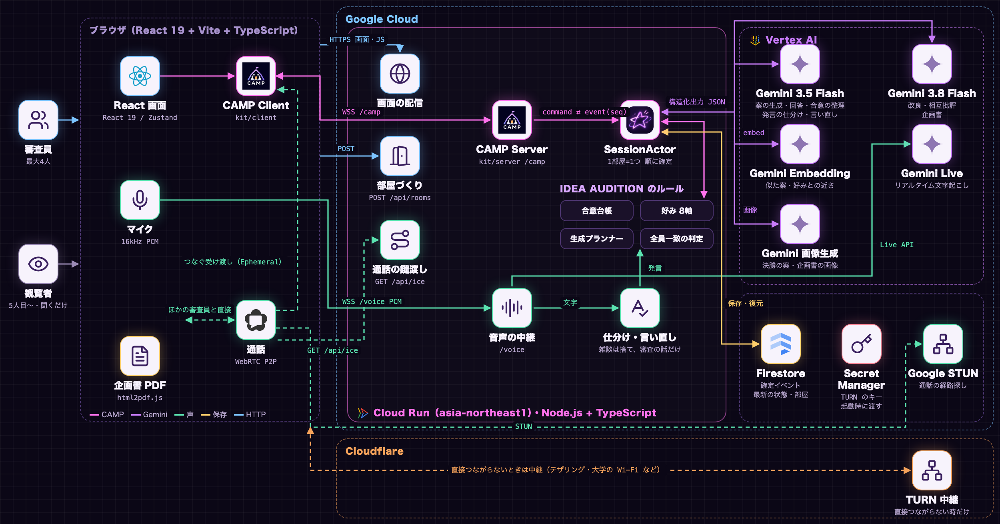

# DevFest GDGoC Japan 2026 Hackathon — プロダクト説明ドキュメント

## チーム情報

| 項目 | 内容 |
|---|---|
| 会場 | 大阪（現地） |
| チーム名 | VICTORY |
| メンバー | 牧 夢斗（リーダー）・丹羽 優貴・宮原 優也・森田 辰樹 |
| アプリケーション名 | IDEA AUDITION |
| キャッチコピー | AI がプレゼン。あなたが審査員。 |
| カテゴリ | クリエイティブ |
| GitHub リポジトリ URL | https://github.com/Devfest-Hackathon-2026/df-2026-t047 |
| デプロイ URL | https://idea-audition-852280753109.asia-northeast1.run.app |

## 【必須項目】

## 1. プロジェクト概要

**IDEA AUDITION — AI がプレゼン。あなたが審査員。**

IDEA AUDITION は、AI と人間の役割を逆転させることで、アイデア創出から合意形成、企画書作成までを一つの体験につなぐ Web アプリケーションです。

従来の生成 AI との対話では、人間が質問や指示を重ねながらアイデアを引き出し、その中から採用する案を選ぶ必要がありました。IDEA AUDITION では、AI が自ら企画を提案する「挑戦者」となり、人間は提案を評価し、対話を通じて方向性を決める「審査員」になります。

ユーザーがテーマを設定すると、AI キャラクターが1人ずつ登場して企画をプレゼンします。最大4人の審査員は、音声通話やチャットで意見を交わし、気になる点を質問できます。全員が賛成した企画は次の段階へ進み、選ばれた企画同士が相互に批評・改良を重ねた後、投票によって最終案を決定します。

本サービスの特徴は、会議中の人間の発言や判断が、その場限りで終わらないことです。会話から論点と賛否を整理した「合意メモ」を作成し、次に登場する企画や既存企画の改良に反映します。最終的には、採択した企画の内容だけでなく、合意事項や改良の経緯も含む企画書を PDF として出力します。

また、エンターテインメント性を重視したオーディション画面に加え、同じ協働ロジックを利用した「オフィシャル会議モード」も用意しています。

本プロジェクトは、DevFest GDGoC Japan Hackathon 2026 のテーマ「Own the Why, Build with Intent.」に対し、**「AI が発想を支援する時代だからこそ、人間が何を選び、なぜ選んだのかを大切にする」**という答えを提示します。

### IDEA AUDITION の価値

1. **AI が提案し、人間が意思決定する**：アイデアを大量に生成するのではなく、全員が納得して1案を選ぶ体験を設計した。
2. **会話が次の提案を変える**：明示的な指示だけでなく、議論中の賛成・反対・迷いを整理し、次の提案や改良につなげる。
3. **その協働を CAMP で成立させる**：複数人の操作と非同期に届く AI の結果を整合させ、判断の履歴を残す。

## 2. 解決する課題

### 2.1 対象ユーザー

学生のプロジェクトやサークル、企画会議やブレインストーミングを行う社会人チームなど、複数人でアイデアを検討し、意思決定するグループです。

### 2.2 課題と根拠

**アイデアを生み出すことより、納得して決めることが難しい**

生成 AI の普及によって、アイデアの候補を短時間で得ることは容易になりました。一方で、複数人で企画を検討する場面には、依然として次の課題があります。

- **選択の難しさ**：候補が増えても、比較や絞り込みの判断基準が明確にならない。
- **合意形成の難しさ**：参加者それぞれの意見や好みが異なり、誰が何に賛成・反対しているのか把握しにくい。
- **議論の継続性**：会話の中で決まった条件が次の提案に反映されず、同じ説明を繰り返すことがある。
- **成果物への接続**：企画を決めた後に、決定理由を整理し直し、企画書を作成する手間が発生する。

IDEA AUDITION は、この課題に対して「提案する AI」と「判断する人間」という役割分担を採用しました。

AI が企画を一つずつ提示することで比較対象を明確にし、参加者全員の意思表示を可視化します。さらに、議論から得られた合意を次の AI の提案に反映することで、会議を進めるほど、提案が参加者の求める方向に近づく体験を目指しました。

**根拠**

- **私たち自身の体験**：このハッカソンの案出しで、生成 AI に聞くと候補はすぐに十分な数がそろった。しかし、どれにするかの判断基準がそろわず、議論が止まった。詰まったのは「案を出す」ところではなく「全員で選び、理由を持って決める」ところだった。これが IDEA AUDITION を作った出発点である。
- **テストユーザーの声**（2026年11月8日〜10日、20人）：評価された点は「会話するだけで欲しかった案に近づく」「誰が何に賛成して決まったかを振り返れる」「決めた企画をそのまま次の作業に使える」に集まった。案の数そのものより、**選ぶ・合意する・理由を残す**ところに価値を感じていることが分かる（詳細は 7.2）。

### 2.3 既存手法との違い

一般的なチャット AI では、人間が指示を入力して回答を得る流れが中心です。ホワイトボード型の会議ツールでは、参加者が案を出し、進行役が議論を整理する必要があります。

IDEA AUDITION では、AI が企画を提案し、参加者の会話から判断条件を読み取り、次の提案や改良に反映します。合意の履歴と企画書作成までを一つの会議体験として統合した点が特徴です。

| | ふつうのチャット AI | 付箋・ホワイトボード | IDEA AUDITION |
|---|---|---|---|
| 案を出す | 1人が AI と話す。ほかの人は見ているだけ | 人が出す。時間がかかる | AI キャラが1人ずつ出す。全員で同時に見る |
| 選ぶ | 1人の判断になりやすい | 声の大きい人に寄る | 全員のブザー（全員一致）と投票。押した・見送ったが記録される |
| 理由を残す | 会話に埋もれる | 写真を撮るだけ | 合意メモ（賛成・反対した人）と改良の履歴が企画書に入る |
| 会議の流れ | なし | 進行役しだい | 予選 → 決勝 → 優勝の流れと持ち時間 |

## 3. Google 技術の活用

### 3.1 使用した Google 技術

- [x] Cloud Run　[ ] App Engine　[ ] Compute Engine　[ ] GKE　[ ] Firebase App Hosting　[ ] Firebase Hosting
- Vertex AI（Gemini）、Firestore、Secret Manager、Cloud Build、Artifact Registry、Google の STUN

### 3.2 Google 技術の活用例

| 技術 | 使っている場所 | 選んだ理由・メリット | デメリット・工夫 |
|---|---|---|---|
| Gemini 3.5 Flash（Vertex AI） | 案の生成・キャラの回答・合意メモの整理・発言の仕分けと言い直し | 返事が速い。構造化出力（JSON のスキーマ）で、画面とサーバーがそのまま使える形で返る | 速さ優先の仕事だけに使い、考えさせる仕事は上の版に分けた |
| Gemini 3.8 Flash（Vertex AI） | 決勝の改良・相互批評・企画書 | 改良や批評の質が上がる | 遅いので、決勝の間に企画書を全員分作り置きし、優勝の瞬間に出す（待ち時間 0 秒） |
| Gemini Live（Vertex AI） | 声の文字起こし | 話しながら文字になる。キャラ名・企画名を語彙として渡せる | 文字起こしは画面に出さず、仕分けて審査の話だけを使う |
| Gemini Embedding | 似た案を出さない・好みとの近さ | 意味の近さで比べられる | — |
| Gemini（画像、`gemini-3.1-flash-lite-image`） | 決勝の案と企画書 PDF のイメージ画像 | 案ごとの画像で、決勝で見比べやすく、企画書も読みやすくなる | 1分に作れる枚数が少ないので、合格した時点から1枚ずつ順に作り、混雑したら待って頼み直す |
| Cloud Run | 画面の配信、CAMP サーバー（WebSocket）、音声の中継、部屋づくり、通話の接続情報 | WebSocket を長くつなげる（タイムアウト 3600 秒）。コンテナ1つで全部動く | 部屋の状態をメモリに持つので、インスタンスは1台に固定し、セッションアフィニティを付けた |
| Firestore | 確定したイベントと最新の状態 | 再起動しても続きから再開できる | 書き込みはまとめて少し遅らせて送る |
| Secret Manager | 通話の中継（TURN）のキー | キーをリポジトリにも画面にも置かない | — |
| Cloud Build・Artifact Registry | コンテナを作って保管し、Cloud Run に出す | 手元の環境に左右されない | — |

### 3.3 Google 技術を選定した理由

本サービスでは、AI の生成品質だけでなく、複数人が同時に操作する会議の応答性、状態の一貫性、運用上の安全性を重視しました。

そのため、AI の処理を一つのモデルに集約せず、企画の生成や発言の整理など応答速度が重要な処理と、企画の改良・相互批評・企画書作成など内容の充実度が重要な処理を分離しました。

また、Gemini へのアクセスは Cloud Run 上のサーバーから Vertex AI 経由で行い、ブラウザ側に AI の認証情報を保持しない構成としています。

複数人の操作と AI の非同期処理を扱うため、WebSocket 上に独自のアプリケーション層プロトコル「CAMP」を実装しました。AI の応答が届く順番と、会議で確定した判断の順番が異なる場合でも、古い判断に基づく結果が現在の会議に混入しないよう設計しています。

さらに、初回の企画生成や企画書作成を先行して実行することで、ユーザーが待ち時間を感じにくい体験を目指しました。

- **Vertex AI 経由で呼ぶ**：Cloud Run のサービスアカウントで認証するので、API キーを持たない（リポジトリにもブラウザにも置かない）。
- **AI はサーバーだけが呼ぶ**：ブラウザから直接呼ぶと、キーが漏れるうえ、4人の操作と AI の結果の順番を保証できない（ADR-0003・ADR-0005）。
- **仕事ごとにモデルを分ける**：速さが要る仕事は 3.5 Flash、質が要る仕事は 3.8 Flash（ADR-0005）。

## 4. アーキテクチャ図

**要点**

- ブラウザ（最大4人＋観覧）と Cloud Run の間は WebSocket が2本。`/camp` は操作、`/voice` は声
- **CAMP**（自作のプロトコル、OSS として npm に公開）が、4人の操作と遅れて届く AI の結果を部屋ごとに1つの順番で確定する。二重実行を防ぎ、古い前提の AI の結果は捨てる。つなぎ直しには本人だけが知る鍵を使う。比較実験では、従来の作りで起きた「操作が消える・二重になる・古い答えが混ざる」が**すべて 0**、速さは**ふつうの WebSocket と同じ**
- 通話はブラウザどうしを直接つなぐ（WebRTC）。直接つながらない回線だけ TURN で中継

## 5. プロジェクトをデプロイした URL

アプリケーション URL：https://idea-audition-852280753109.asia-northeast1.run.app （11/14 の Regional Day まで動かし続けます）

## 【任意項目】

## 6. 動作確認の方法

### 6.1 テストアカウント情報

ログインやアカウント登録はありません。URL を開くだけで使えます。

### 6.2 動作確認手順

1. 上記 URL にアクセスし、「オーディションを作る」を押します。
2. 名前を入力して部屋に入ります。
3. テーマ・持ち時間・合格者の数を決め、「オーディションをはじめる」を押します。
4. AI キャラクターが1人ずつ企画をプレゼンします。気になる点は文字かマイクで質問し、良いと思ったらブザーを押します。審査員全員がブザーを押すと合格です。
5. 決勝では、キャラクターの名前を呼んで改良を頼み、投票で優勝を決めます。
6. 優勝が決まると、企画書（PDF）をその場で開いて、ダウンロードできます。

- **複数人で試す**：部屋のリンクを別のタブ・別の端末で開きます（審査員は4人まで、5人目からは観覧）。
- マイク・カメラは任意です（許可しなくても、文字の発言とボタンで最後まで進められます）。
- ヘッダーの切り替えで、オフィシャル会議モード（会議ツールの画面）も試せます。

### 6.3 サンプルデータ

事前に登録したデータは不要です。テーマの例：「大学の学食をもっと楽しくする企画」。手元で動かす場合は、README の「起動」（`pnpm install` → `pnpm dev`）で、Google Cloud の権限が無くても固定データで全機能を試せます。

## 7. アプリの詳細や機能に関する自由記述

### 7.1 主な機能

- 予選：1人ずつのプレゼン、ゴールデンブザー（全員一致）、残り時間とタイマーの音、深掘りの間は時間が止まる、一時停止、合格者の待機室
- 決勝：相互批評と改良、スポットライト、版の履歴と巻き戻し、優勝投票（だれが投票済みかを表示）、結果発表と表彰
- 企画書：作り置きで**待ち時間 0 秒**（以前は 11〜13 秒）、画像入りの PDF、その場でめくって見られる
- 会話：声の文字起こし、発言の仕分け・言い直し、合意メモ（賛成・反対した人と人数）
- 好み：押した・見送った・迷ったから8軸の好みを読み、次の案に使う
- 通話：声と顔（ワイプ）、どの場面でも同じ場所でマイク・相手の声・効果音を切り替え
- オフィシャル会議モード：同じ仕組みのまま、会議ツールの画面と言葉に切り替える
- CAMP：OSS として公開（https://github.com/camp-protocol/camp 、npm `@camp-protocol/kit`）

### 7.2 実測の数字とユーザーの声

| 測定項目 | 結果 | 測定方法・出典 |
|---|---|---|
| 最初の挑戦者が登場するまで | **25倍以上高速化**：約1.6秒 → 約0.06秒 | 開発ログ。テーマ入力中に企画を事前生成 |
| 優勝決定から企画書表示まで | **待ち時間0秒**：11〜13秒 → 0秒 | 開発ログ。決勝中に企画書を事前生成 |
| 自動テスト | **235件**（CAMP 21件、サーバー193件、画面17件、語彙4件） | `pnpm test`（2026年11月10日） |
| CAMP：通信切断時の操作保護 | **操作の消失0件・重複0件**。従来構成では消失18件、再送による重複24件 | 4人・2,200操作・切断102回の模擬実験 |
| CAMP：古いAI応答の混入防止 | **混入0/30回**。従来構成では30/30回（100%）混入 | AIの処理中に議論の前提を変更する比較実験 |
| CAMP：状態反映速度 | **約84ms（中央値）**。通常のWebSocketと同等の速度 | ローカル模擬通信環境での比較実験（2026年11月10日） |

※CAMPの比較結果は、2026年11月10日に実施したローカルの模擬通信環境での測定値です。比較対象は、同じ会議操作を従来の通信方式で実装した構成です。

#### テストユーザーの声

**実施期間：2026年11月8日〜10日／テストユーザー：20人**

以下は、テスト利用で寄せられた感想の要点を、内容別に5件抜粋・要約したものです。

**① 会話するだけで、欲しかった案に近づく**

「AIに毎回指示を出さなくても、みんなで話しているうちに、自分たちが求めていた方向のアイデアが出てくるのがよかった。」

**② うまく言葉にできない好みも反映される**

「最初は何がいいか自分でも曖昧だったけど、話し合いを重ねるうちに、しっくりくる案が出てきた。」

**③ 楽しみながら、短時間で決められる**

「オーディション形式で盛り上がっていたら、体感ではあっという間に企画が決まっていた。」

**④ 決めた企画を、そのまま次の作業に使える**

「最後に企画書のPDFまで作ってくれるので、会議が終わったあと、すぐに企画を進められるのが便利だった。」

**⑤ なぜその企画に決まったのか、振り返れる**

「誰が何に賛成して、どんな話し合いを経て決まったのかが残るので、あとから確認しやすい。」

これらのフィードバックから、単にアイデアを生成するだけでなく、**会話から提案を改善し、意思決定と成果物作成までを一つにつなげる体験**に価値が感じられていることがうかがえます。

### 7.3 今後の展望

- 審査員も案を出せるようにする
- 声の調子（乗り気・迷い）を読んで AI の文脈に入れる
- 部屋全員でオフィシャル会議モードをそろえる
- 会議ごとの指標（案の数・決まるまでの時間・発言の偏り）を自動で出す

## 【採点外項目】

## 8. AI をどの場面でどう使用したか、なぜその場面で使用したか

- **サービスの中**：Gemini だけを使う（3.2 の表）。AI は案を出す役、決めるのは人間、という役割分担がアプリの中心
- **開発**：AI の支援を受けながら、設計の壁打ち・実装・テスト・レビューを進めた。設計の判断は ADR（`docs/adr`）に、人間が決めた理由と比べた案を残している。キャラクター・ロゴ・スライドの画像は、メンバーが画像生成 AI で作った（出どころは著作物利用シートに記載）
- **なぜその場面か**：案を出す・整理する・文書にするのは、AI が速く、数も出せる。一方で「どれを選ぶか」は参加者の価値観で決まるので、人間に残した。開発でも同じで、AI には複数の案を出させ、比べて選んだ理由を人間が ADR に書いた

## 9. 自分たちが開発を通して何を得て、どれくらい成長できたのか

**牧 夢斗**

今回の開発では、リーダーとして4人のメンバーの役割分担や開発方針を考え、それぞれが担当する機能を一つのプロダクトとしてまとめることに取り組みました。限られた開発期間の中で、機能の優先順位を判断しながら、UI・音声認識・AIとの対話・企画書生成などを連携させる難しさを実感しました。また、独自プロトコルCAMPの開発や比較実験を通じて、技術を実装するだけでなく、その必要性や価値を客観的に示すことの重要性も学びました。今回の経験を通して、個々の技術力だけでなく、チーム全体の力を一つの目標に向けて引き出し、ユーザーに価値のあるプロダクトとして完成させることが、リーダーの大切な役割だと実感しました。

**丹羽 優貴**

大企業の会議作法とGoogle Meetの調査をもとに、オフィシャル会議モードの設計と実装を担当した。既存のコードを読み解き、バックエンドに触れず表示の仕組みだけで新しいモードを足す進め方と、PRを通じたチーム開発の流れを実践できた。

**宮原 優也**

雑談から、テーマや話題にあっているかをAIで即時判定・抽出するプロンプト設計や、案の切り替えに連動して語彙を文字起こしへ動的に渡し直す制御の実装を体験できました。ハッカソンの超短期間の中で企画から実用レベルの対話アプリを完成させる難しさと面白さを肌で実感できました。

**森田 辰樹**

今回の開発では、PDFの表示に関する機能修正に加え、画像やGeminiを活用した表現の工夫など、ユーザー体験の向上を中心に取り組みました。限られた開発期間の中で、単に機能を実装するだけでなく、使いやすさや情報の伝わりやすさまで追求することの難しさを実感しました。チームで試行錯誤を重ねながら、技術をユーザーにとって価値のある体験へと結びつけていく、プロダクト開発の奥深さと面白さを学ぶことができました。
